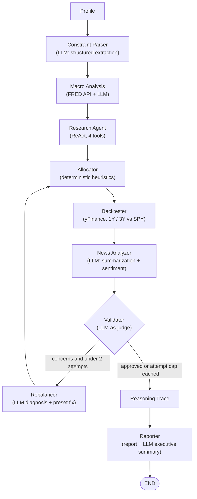

# FinPlan-LLM: A Multi-Agent Financial Advisory System

An agentic LangGraph workflow that turns an investor profile and free-text constraints into a validated, explainable ETF portfolio with backtests and a downloadable PDF report.

**Core design principle:** *LLMs for reasoning and soft decisions, heuristics for hard financial decisions.*

LLMs handle understanding, research, synthesis, and judgment. Deterministic code makes the allocation and computes every number, so the decisions that move money stay auditable and free of hallucination.

---

## Why agentic?

Ask a single LLM prompt to *"create a portfolio for a 62-year-old conservative investor with a 7-year horizon"* and you get a plausible answer, but:

1. It relies on training data, not current market data.
2. Nothing validates or backtests it.
3. It cannot reliably enforce constraints like "no oil, ESG focus, avoid China."
4. There is no reasoning trace to audit.
5. Hallucinated tickers or numbers are a real risk in financial advice.

FinPlan-LLM addresses each of these with tool use, live data, deterministic allocation, an LLM-as-judge validator, and a self-correcting rebalance loop.

---

## Architecture

The system is a LangGraph `StateGraph` with shared typed state (`FinancialPlanState`) and conditional routing.



### Nodes

| Node | Decision type | What it does |
|---|---|---|
| **Profile** | Input | Loads the investor profile: age, risk tolerance, goal, time horizon, and free-text constraints. |
| **Constraint Parser** | LLM | Parses free-text constraints into JSON (`exclude_tags`, `require_esg`, `preferences`, `unmatched_constraints`), then deterministically filters the ETF universe using metadata tags. |
| **Macro Analysis** | API + LLM | Pulls the Fed funds rate, CPI, unemployment, and GDP from FRED. An LLM writes a short interpretation for investors. |
| **Research Agent** | ReAct agent | Autonomously chooses and sequences tool calls to pick one ETF per asset class (details below). |
| **Allocator** | Heuristic | Computes asset-class weights from age, risk, horizon, goal, and macro-regime rules. |
| **Backtester** | API | Backtests the portfolio over 1-year and 3-year windows and benchmarks the 1-year result against SPY. |
| **News Analyzer** | LLM | Summarizes news for the top holdings into a summary, sentiment, confidence, portfolio impact, and key risks. |
| **Validator** | LLM-as-judge | Runs a 5-step chain-of-thought review and returns APPROVED or CONCERNS NOTED. |
| **Rebalancer** | LLM + heuristic | The LLM diagnoses the validator's concerns; fixed rules apply the matching fix. |
| **Reasoning Trace** | Deterministic | Builds a step-by-step explanation of every allocation decision. |
| **Reporter** | Template + LLM | Assembles the final report; an LLM writes the executive summary. |

---

## The research agent (ReAct)

Built with LangGraph's `create_react_agent` on Gemini 2.5 Flash. The LLM decides which tools to call, in what order, and when it has enough information.

| Tool | Purpose |
|---|---|
| `screen_asset_class` | Ranks ETFs in an asset class (skipping excluded tickers) by a score combining Sharpe ratio, trailing return, AUM, max drawdown, and expense ratio, with an optional ESG bonus. |
| `compare_etfs` | Head-to-head comparison of two ETFs on return, Sharpe ratio, max drawdown, expense ratio, and ESG flag, with a recommendation. |
| `get_etf_details` | Price, return, volatility, expense ratio, AUM, ESG flag, and metadata tags for a single ETF. |
| `fetch_market_news` | Recent headlines for an ETF or topic (see *Known limitations*). |

The prompt requires the agent to screen every asset class, run `compare_etfs` on the top two candidates for US stocks and bonds, and check news for at least two asset classes. If the agent's output cannot be parsed, the node falls back to the deterministic screener so the pipeline always completes.

**Universe:** 48 ETFs across 5 asset classes (US stocks, international stocks, bonds, REITs, commodities), each tagged for filtering (e.g. `oil`, `fossil_fuel`, `china_exposure`, `emerging_markets`, `esg`).

---

## Allocation heuristics

The allocator is fully deterministic:

1. **Base equity:** `100 - age`
2. **Risk tolerance:** conservative `-20` (floor 20%), aggressive `+20` (cap 90%), moderate unchanged
3. **Time horizon:** under 5 years `-20`, over 30 years `+10`
4. **Goal:** goal-specific splits across the 5 asset classes (e.g. house down payment, retirement, wealth building)
5. **Macro regime:** rule-based adjustments, then clip negatives and normalize to 100%

| Regime | Trigger | Main shift |
|---|---|---|
| Stagflation | Low GDP, high inflation, high unemployment | More commodities and bonds, fewer stocks and REITs |
| Recession | Negative GDP, high unemployment | More bonds, fewer stocks |
| Strong Growth | GDP > 2.5%, low unemployment and inflation | More stocks and REITs |
| High Inflation | Inflation > 4% | More commodities and bonds |
| Rising Rates | Fed funds > 4% | Slightly more bonds |
| Goldilocks | Default | No adjustment |

---

## Reflection loop: validate, diagnose, rebalance

**Validator (LLM-as-judge).** Reviews the full plan with step-by-step reasoning:

1. Age appropriateness
2. Goal alignment
3. Risk tolerance match
4. Constraint compliance
5. Risk metrics (Sharpe, max drawdown, volatility)

**Conditional routing.** If the validator raises concerns and fewer than 2 rebalance attempts have been made, the graph routes to the rebalancer. Otherwise it continues to the report.

**Rebalancer.** An LLM classifies the concern, and deterministic rules apply the fix:

| Diagnosis | Fix |
|---|---|
| `TOO_AGGRESSIVE` | Shift to a more conservative preset |
| `TOO_CONSERVATIVE` | Shift to a more aggressive preset |
| `CONCENTRATION_RISK` | Shift to the balanced (moderate) preset |
| `CONSTRAINT_VIOLATION` | Keep the allocation and flag it for human review |

The revised plan loops back through the allocator, backtester, news analyzer, and validator. After 2 attempts the loop exits and the report carries a human-review disclaimer.

---

## Backtesting

Using yFinance historical prices, the backtester computes for the weighted portfolio:

- Total and annualized return
- Volatility
- Sharpe ratio
- Max drawdown
- Best and worst day

It runs over **1-year** and **3-year** windows and separately backtests **SPY** over 1 year to report the portfolio's relative performance.

---

## Explainability: three layers

| Layer | Audience | What you get |
|---|---|---|
| **Console logs** | Developer (debugging) | Step-by-step execution output from every node |
| **PDF report** | End user | Executive summary, allocation and pie chart, constraint analysis, economic analysis, research summary, news and sentiment, backtest chart and metrics, decision reasoning, validation results |
| **LangSmith** | Developer (observability) | Full traces of every LLM call and tool call, nested agent steps, latency, token counts, shareable run links |

---

## Example

**Input:** 62 years old, conservative, capital preservation, 7-year horizon.

The research agent screened every asset class, compared VOO vs IVV and VCIT vs USIG head to head, and selected:

| Asset class | Weight | ETF |
|---|---|---|
| Bonds | 68% | VCIT |
| Commodities | 13% | GLDM |
| US stocks | 11% | VOO |
| International stocks | 5% | EEM |
| REITs | 3% | REM |

The validator approved the plan with 0 rebalance attempts. See `financial_plan_report_1.pdf` for the full generated report.

---

## Tech stack

- **Orchestration:** LangGraph, LangChain
- **LLM:** Gemini 2.5 Flash (`langchain-google-genai`)
- **Data:** FRED API (`fredapi`), yFinance
- **Observability:** LangSmith
- **Reporting:** ReportLab, Matplotlib
- **UI:** Gradio

---

## Getting started

The project is a single notebook built for **Google Colab**.

1. Open `FinPlan_LLM_Notebook.ipynb` in Colab.
2. Get API keys:
   - [Google AI Studio](https://aistudio.google.com/) (Gemini): `GOOGLE_API_KEY`
   - [FRED](https://fred.stlouisfed.org/docs/api/api_key.html): `FRED_API_KEY`
   - [LangSmith](https://smith.langchain.com/) (optional, for tracing): `LANGCHAIN_API_KEY`
3. Add the keys in the setup cell. Colab Secrets are recommended over pasting keys into the notebook.
4. Run all cells. The first cell installs dependencies:
   ```bash
   pip install langchain langchain-google-genai langchain-core langgraph yfinance fredapi pandas numpy reportlab gradio
   ```
5. The last cell launches a Gradio app with a public link. Enter age, risk tolerance, goal, horizon, and any constraints (e.g. *"No oil, ESG focus, avoid China exposure"*), then download the PDF report.

---

## Repository structure

```
.
├── FinPlan_LLM_Notebook.ipynb   # Full implementation: nodes, tools, graph, reporting, UI
├── financial_plan_report_1.pdf  # Sample generated report
├── FinPlan-LLM.pptx             # Project presentation
└── README.md
```

---

## Known limitations

- **News is stubbed.** `fetch_market_news` currently returns placeholder headlines, so news summaries and sentiment are illustrative. A live feed is on the roadmap.
- **Macro inputs are simplified.** FRED's CPI series is an index level, so inflation is currently a fixed 3.0% placeholder, and GDP parsing drops negative signs. As a result, only the Rising Rates and Goldilocks regimes can currently trigger.
- **Backtests are in-sample.** ETFs are screened on trailing metrics and then backtested over the same trailing windows, so results describe the past and are not predictive.
- **Validator parsing is lenient.** The status check approves if "[OK]" or "APPROVED" appears anywhere in the response. Structured output would make it stricter.
- **PDF display issues.** The 1-year chart is an illustrative curve drawn from total return (the metrics table uses real prices), and annualized return shows 0.00% because of a key mismatch.

## Roadmap

- Live news via NewsAPI or Yahoo Finance RSS, with source citations
- Year-over-year CPI and signed GDP growth so all six regimes are reachable
- Structured (JSON) validator output
- Walk-forward, out-of-sample backtesting
- An evaluation harness across many investor profiles, comparing against a single-prompt LLM baseline on constraint violations, validator agreement, and rebalance rate
- Multi-turn plan refinement, a user feedback loop, and more asset classes and tools

---

## Acknowledgments

Built by **Harsh Vijay Mamania** as the final project for DS 5983: Introduction to Large Language Models, Khoury College of Computer Sciences, Northeastern University (December 2025).

## Disclaimer

This project is for educational purposes only and does not constitute financial advice. Past performance is not indicative of future results.
